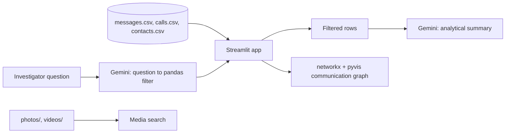

# UFDR Analyzer: AI-assisted forensic report explorer

A Streamlit dashboard that lets an investigator explore the contents of a phone-extraction report (messages, call logs, contacts, photos and videos) with natural-language questions, a communication-network graph and media search. The bundled case, "Operation Digital Shadow", is entirely synthetic. Built for **Smart India Hackathon 2025**.

**Links:** [GitHub](https://github.com/shriram-s7/UFDR-ANALYZER-TOOL) · [Demo video](https://youtu.be/Ydn5dh8-xas)

## Overview

A UFDR (Universal Forensic Extraction Device Report) holds thousands of messages, calls and media files, which is slow to review by hand. This prototype puts a conversational layer on top: you type a question such as "urgent messages from John Doe", Gemini converts it into a pandas filter over the data, and a second Gemini call summarises the results with key entities and red flags. A network graph shows who talks to whom, and the media tabs let you search photos and videos by content. It was built as a Smart India Hackathon 2025 entry, and it runs only on the fake data in this repository (generated with Faker).

## Features

- **Case overview** with the scenario brief.
- **Messages and call logs:** natural-language questions with follow-ups (the previous result set is kept), AI-generated filters and an AI analytical summary.
- **Contacts** table.
- **Relationship graph:** a pyvis network of all participants weighted by interaction count, with the three key suspects highlighted (also saved as `communication_network.html`).
- **Photos and videos:** search by keyword and browse matching media.
- **Two app variants** with different media handling (see below).

## How it works



| App | Media analysis |
|---|---|
| `app.py` | Searches **keywords taken from file names** (for example `rooftop_exchange_...mp4`). The "AI is analysing" spinner is a fixed delay; no vision model runs. |
| `app1.py` | Runs real local models on the media: DETR object detection (`facebook/detr-resnet-50`) and BLIP captioning (`Salesforce/blip-image-captioning-base`) on photos and sampled video frames, cached after the first run. It needs `transformers`, `torch` and OpenCV and downloads the models on first use. |

Both apps use Gemini (`models/gemini-pro-latest`) for text queries. In `app.py` the queries about "John Doe" (and their summary) are **hard-coded canned responses** so the demo works reliably.

## Tech stack

| Layer | Technology |
|---|---|
| UI | Streamlit |
| Data | pandas, Faker (synthetic data generators) |
| LLM | Google Gemini via `google-generativeai` |
| Graph | networkx, pyvis |
| Media AI (`app1.py` only) | transformers (DETR, BLIP), PyTorch, OpenCV, Pillow |

## Project structure

```text
app.py, app1.py              the two Streamlit apps
config.py                    reads GOOGLE_API_KEY from the environment
.env.example                 placeholder for the key
generate_all_data.py         builds messages.csv, calls.csv, contacts.csv with Faker
generate_mock_data.py        earlier/smaller generator
messages.csv, calls.csv, contacts.csv   synthetic case data
communication_network.html   exported network graph
photos/, videos/             synthetic media for the case
```

## Getting started

Prerequisites: Python 3.10+ and a Google Gemini API key. There is no `requirements.txt`, so install the packages directly.

**Windows (PowerShell)**

```powershell
python -m venv .venv
.\.venv\Scripts\Activate.ps1
pip install streamlit pandas networkx pyvis google-generativeai faker
$env:GOOGLE_API_KEY = "<your-key>"
streamlit run app.py
```

**Linux / macOS**

```bash
python3 -m venv .venv && source .venv/bin/activate
pip install streamlit pandas networkx pyvis google-generativeai faker
export GOOGLE_API_KEY="<your-key>"
streamlit run app.py
```

For `app1.py` also run `pip install opencv-python pillow transformers torch`.

Environment variable: `GOOGLE_API_KEY`, your own Gemini key (see `.env.example`). It is read from the environment only, not from a `.env` file. The CSV files are included; to regenerate them run `python generate_all_data.py` (needs Faker).

## Usage

1. Start the app and open the URL Streamlit prints.
2. In **Messages**, try "messages about the package" or "messages from John Doe", then refine with a follow-up.
3. Open the **Relationship Graph** to see the network, then **Photos** and **Videos** and search for words such as "rooftop" or "usb".

## Tests

There are no automated tests. The apps were not launched while writing this README, because they need a Gemini key.

## Status and limitations

- Prototype on synthetic data only; do not use it with real evidence.
- `app.py` fakes the photo/video AI analysis (filename search and a delay) and hard-codes the John Doe demo path; `app1.py` is the one with real media models.
- The Gemini-generated pandas filter is evaluated as code, which is unsafe for untrusted input.
- `app1.py` still shows an outdated "config.py file not found" message if the API key is missing; set `GOOGLE_API_KEY` as described.

## License

No license specified. The earlier README described the project as "for educational purposes only".
